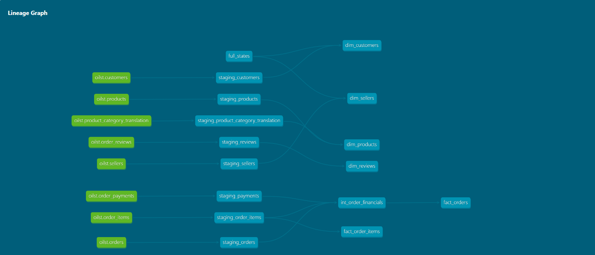
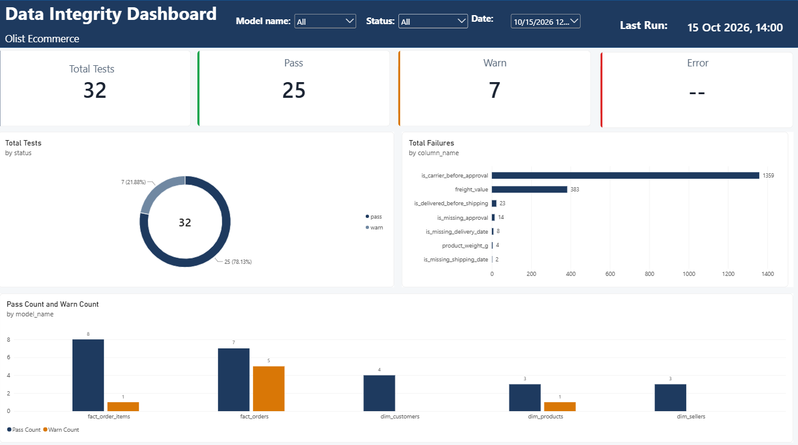

# Oilst E-Commerce · dbt Analytics Project

A production-style dbt project built on the Brazilian E-Commerce public dataset (Olist / Kaggle). The project demonstrates a full analytics engineering workflow — raw ingestion, layered modelling, a custom generic test, elementary observability, and a standalone data quality dashboard.

---

## Lineage DAG

> **To generate this image:** run `dbt docs generate && dbt docs serve` in your project, open the lineage graph in the browser, take a screenshot, save it as `docs/lineage_dag.png`, then replace this placeholder.



The pipeline runs in four layers: **raw** (Postgres source tables) → **staging** (renames + boolean flag computation) → **intermediate** (cross-source joins) → **mart** (`dim_*` + `fact_*` tables). Elementary captures test results into a separate `dbt_dev_elementary` schema after every run.

---

## Data Quality Dashboard

A standalone HTML dashboard visualises every test result — health gauge, KPI tiles, failure breakdown chart, model health matrix, and anomaly insights. No server required; open directly in a browser.

> **To add this screenshot:** open `docs/data_integrity_dashboard.html` in Chrome, take a full-page screenshot, save it as `docs/screenshots/dashboard_integrity.png`.



---

## Dashboard Insights Panel

The insights panel surfaces five core KPIs that reframe standard e-commerce 
metrics as operational truth: review sentiment concentration, freight burden 
relative to order value, seller revenue inequality, delivery tolerance (late 
but still loved), and median delivery breach days.


> **To add this screenshot:** scroll to the "Data quality insights" section of the dashboard and screenshot the three insight cards, save as `docs/dashboard_insights.png`.


---

## Tech Stack

| Tool | Version | Role |
|---|---|---|
| dbt Core | 1.9.11 | Transformation framework |
| dbt-postgres | 1.9.1 | Postgres adapter |
| dbt-expectations | latest | Extended test library (range, row-count) |
| elementary | 0.15.x | Test observability — populates `dbt_dev_elementary` |
| PostgreSQL | 16 | Analytical warehouse |
| Python | 3.12 | dbt runtime |
| HTML / Vanilla JS | — | Standalone data quality dashboard (`docs/data_integrity_dashboard.html`) |

---

## Architecture

```
PostgreSQL (raw schema)
    └── 8 source tables (orders, order_items, payments,
        reviews, customers, sellers, products, translations)
             │
         dbt run
             │
     ┌───────┴────────┐
  Staging           Staging
  (renames)     (boolean flags)
     └───────┬────────┘
         Intermediate
       (cross-source join)
             │
      ┌──────┴──────┐
   dim_*          fact_*
(customers,    (fact_orders,
 products,    fact_order_items)
 sellers)
             │
         dbt test
             │
   dbt_dev_elementary schema
   (elementary_test_results)
             │
   Data Integrity Dashboard
```

---

## Project Structure

```
oilst_ecommerce/
├── models/
│   ├── staging/
│   │   └── staging_orders.sql          # Business logic as boolean flags
│   ├── intermediate/
│   │   └── int_orders_enriched.sql
│   ├── marts/
│   │   ├── dim_customers.sql
│   │   ├── dim_products.sql
│   │   ├── dim_sellers.sql
│   │   ├── fact_orders.sql
│   │   └── fact_order_items.sql
│   ├── schema.yml                      # All tests defined here
│   └── sources.yml                     # Raw source declarations
├── tests/
│   └── generic/
│       └── flag_is_false.sql           # Custom generic test macro
├── docs/
│   ├── data_integrity_dashboard.html   # Standalone quality dashboard
│   ├── lineage_dag.png                 # dbt docs lineage screenshot
│   └── screenshots/
│       ├── dashboard_integrity.png
│       └── dashboard_insights.png
├── packages.yml                        # dbt-expectations, elementary
└── dbt_project.yml
```

---

## Data Sources

Eight source tables loaded into the `raw` schema from the [Olist Brazilian E-Commerce dataset](https://www.kaggle.com/datasets/olistbr/brazilian-ecommerce):

| Table | Rows (approx.) | Description |
|---|---|---|
| `orders` | 96,478 | Order header with status and timestamps |
| `order_items` | 112,650 | Line items: product, seller, price, freight |
| `order_payments` | 103,886 | Payment method and instalment records |
| `order_reviews` | 99,224 | Customer review scores and comments |
| `customers` | 99,441 | Customer geolocation and city |
| `sellers` | 3,095 | Seller geolocation |
| `products` | 32,951 | Product dimensions and category |
| `product_category_translation` | 71 | PT → EN category name mapping |

---

## Key Engineering Decisions

### Boolean flag pattern in staging

Rather than writing singular tests that embed business logic in SQL, all lifecycle-validation logic is computed **once** in `staging_orders.sql` as boolean flag columns:

```sql
case
    when order_status in ('approved','delivered','shipped')
     and order_approved_at is null then TRUE
    else FALSE
end as is_missing_approval,

case
    when order_approved_at > order_delivered_carrier_date then TRUE
    else FALSE
end as is_carrier_before_approval
-- ... four more flags
```

These flags are then tested with a single custom generic test:

```sql
-- tests/generic/flag_is_false.sql

    select order_id
    from {{ model }}
    where {{ column_name }} = True

```

**Why this approach?** Business logic lives in one place (the staging model), not scattered across test files. Adding a new check is a two-line change: one CASE expression and one test entry in `schema.yml`.

### Referential integrity tests

`fact_order_items` is tested against all three parent dimension tables to guarantee no orphan records survive the pipeline:

```yaml
- name: order_id
  data_tests:
    - relationships:
        to: ref('fact_orders')
        field: order_id
- name: product_id
  data_tests:
    - relationships:
        to: ref('dim_products')
        field: product_id
- name: seller_id
  data_tests:
    - relationships:
        to: ref('dim_sellers')
        field: seller_id
```

---

## Test Results

| Status | Count | Notes |
|---|---|---|
| ✅ PASS | 27 | All structural, uniqueness, referential, and range tests |
| ⚠️ WARN | 7 | Boolean flag tests — real data signals, severity: warn |
| ❌ ERROR | 0 | — |

### What the 7 warnings mean

| Flag | Affected rows | Likely cause |
|---|---|---|
| `is_missing_approval` | 160 | Batch-approval flows — status recorded without timestamp |
| `is_missing_shipping_date` | 89 | Carrier sync lag at time of export |
| `is_carrier_before_approval` | 46 | Mixed UTC offsets in source timestamps |
| `is_missing_delivery_date` | 21 | Terminal status recorded before carrier confirmation |
| `is_delivered_before_shipping` | 12 | Timestamp ordering violation |
| `is_approval_before_purchase` | 8 | Timezone normalisation error |
| `order_purchase_timestamp` not_null | 0 failures | Precautionary warn-severity guard |

**336 total anomalous rows out of 96,478 orders = 0.35% of records.**

---

## Running Locally

**Prerequisites:** PostgreSQL 16, Python 3.12, dbt-core 1.9.11

```bash
# 1. Clone and install dependencies
git clone https://github.com/Archad775/Olist_ecommerce.git
cd Olist_ecommerce
pip install dbt-core==1.9.11 dbt-postgres==1.9.1

# 2. Create ~/.dbt/profiles.yml targeting your local Postgres instance

# 3. Install dbt packages
dbt deps

# 4. Load raw CSVs into the raw schema (DDL in /setup), then run
dbt run
dbt test

# 5. Open the dashboard
start docs/data_integrity_dashboard.html
```

---

## Dataset Credit

[Brazilian E-Commerce Public Dataset by Olist](https://www.kaggle.com/datasets/olistbr/brazilian-ecommerce) — released under CC BY-NC-SA 4.0.
